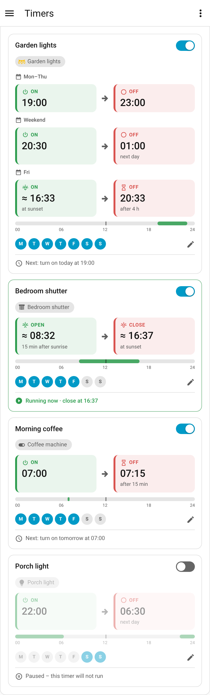
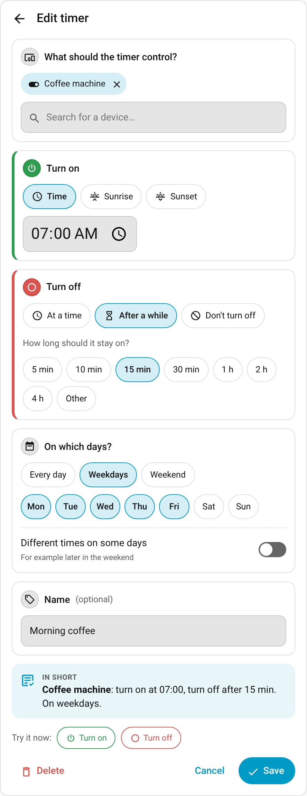
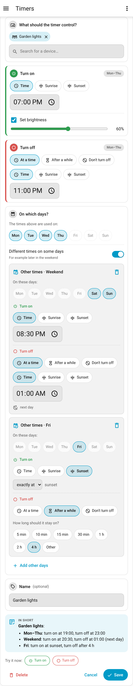

# Timercard for Home Assistant

An easy timer card for Home Assistant. Every timer shows **one "on" moment
and one "off" moment together**, so you can see at a glance what turns a
device on and what turns it off again.

<p>
  
  
</p>

- 🟢 **On** and 🔴 **Off** in the same timer: "Garden lights: on at 19:00, off at 23:00"
- ⏰ Turn on at a **set time**, at **sunrise** or at **sunset** (with an offset, e.g. "15 min after sunrise")
- ⌛ Turn off at a set time, at sunrise/sunset, **after a while** (e.g. "after 15 min"), or not at all
- 🌙 Off time earlier than on time (e.g. 22:00 → 06:30) means **the next day**
- 📅 Pick days with one tap: *Every day*, *Weekdays*, *Weekend*, or single days
- 🗓️ Optional **different times on some days** (e.g. later in the weekend). It stays hidden until you switch it on
- 💡 Optional extras: brightness for lights, temperature for thermostats, position for covers
- 📝 A plain-language **"In short"** sentence that shows exactly what the timer will do
- 📊 A 24-hour bar per timer showing when the device is on, plus "Next: turn on today at 19:00"
- ⏸️ Pause a timer with its toggle. Each timer is also a `switch.timercard_…` entity, so automations can pause timers too (e.g. on holiday)
- ▶️ "Try it now" buttons to test a timer straight away
- 🇬🇧 English and 🇳🇱 Dutch (follows your Home Assistant language)

The timers are stored and run by Home Assistant itself, so they keep working
when no dashboard is open and after a restart.

## Installation

### HACS (recommended)

1. HACS → ⋮ → **Custom repositories** → add `https://github.com/just2701/timercard-ha`, type **Integration**.
2. Install **Timercard** and restart Home Assistant.
3. **Settings → Devices & services → Add integration → Timercard**.
4. Refresh your browser, edit a dashboard, **Add card** and choose **Timercard**.

### Manual

Copy `custom_components/timercard` into the `custom_components` folder of your
Home Assistant config, restart, then follow steps 3 and 4 above.

You don't need to add a dashboard resource: the integration loads the card for you.

## Different times on some days

At the bottom of **On which days?** there is a switch **Different times on
some days**. It is off by default, so a normal timer stays simple.

Switch it on and an **Other times** block appears, already set to Saturday and
Sunday, with its own *turn on* and *turn off* moments (copied from the main
times, so you only change what is different). Use **Add other days** for more
blocks, e.g. a late Friday. Every day can belong to one set of times only:
tapping a day in one block moves it there from the other block. Switching the
option off again gives all days the main times.



## Card options

```yaml
type: custom:timercard-card
title: Garden            # optional, default "Timers"
entities:                # optional: only these devices can be picked,
  - light.garden_lights  #   and only timers that use them are shown
  - switch.pond_pump
```

Leave `entities` out to choose from every supported device. All options can
also be set in the visual card editor.

Supported device types: lights, switches, fans, input booleans, automations,
media players, climate, humidifiers, sirens, water heaters, remotes, covers
(open/close), valves (open/close), locks (unlock/lock), vacuums and lawn
mowers (start/dock), scripts (run/stop), and scenes and buttons (on only).

## Using timers in automations

Each timer has a switch entity, for example `switch.timercard_garden_lights`:

- turning the switch **off** pauses the timer, **on** resumes it;
- its attributes contain `next_on`, `next_off`, `active`, `entities`, `days`
  and `overrides` (the "other times", if any).

Every time a timer runs, Home Assistant fires the event `timercard_executed`
with `timer_id`, `name`, `event` (`on`/`off`) and `entities`.

## Good to know

- The days you select are the days the timer **starts**. A Friday timer
  from 22:00 to 06:00 turns off on Saturday morning.
- If Home Assistant is not running at the moment a timer should fire,
  that moment is skipped (it is not caught up after a restart).
- Times are in your Home Assistant time zone.

## Development

```bash
pip install -r requirements_test.txt
pytest
```
